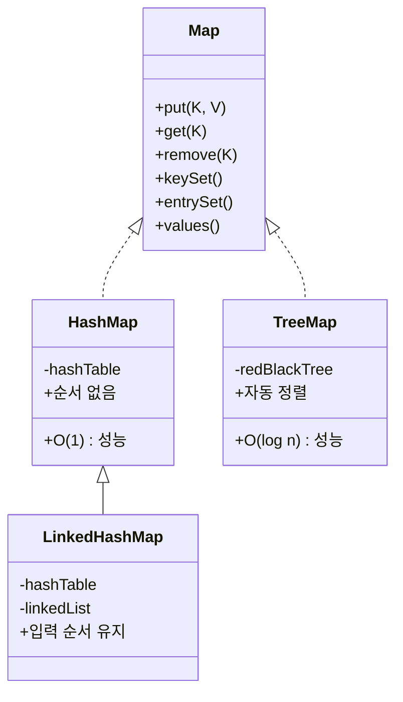

## 📘 Map 인터페이스 개요
### 📌 Map 구현체 특징 요약

| 항목               | HashMap                  | LinkedHashMap              | TreeMap                    |
|--------------------|--------------------------|-----------------------------|----------------------------|
| 순서 유지 여부     | ❌ 유지 안 됨             | ✅ 입력 순서 유지           | ❌ 입력 순서 무시, 값 기준 정렬 |
| 정렬 여부          | ❌ 없음                  | ❌ 없음                     | ✅ 자동 정렬됨             |
| 성능               | `O(1)` 평균              | `O(1)` 평균                 | `O(log n)`                 |
| 내부 구조          | 해시 테이블              | 해시 테이블 + 링크드 리스트 | 레드-블랙 트리             |
| 키 중복 여부       | ❌ 중복 불가             | ❌ 중복 불가                | ❌ 중복 불가               |
| 값 중복 여부       | ✅ 중복 가능             | ✅ 중복 가능                | ✅ 중복 가능               |
| 주요 용도          | 빠른 검색, 기본 맵       | 순서 유지가 필요한 경우     | 정렬된 맵, 범위 검색 필요 시 |


### 📌 주요 메서드별 샘플과 설명
#### 🔹 1. put(K key, V value)
- 키-값 저장 (같은 키면 값 덮어쓰기)
```java
Map<String, Integer> map = new HashMap<>();
map.put("A", 100);
map.put("A", 200); // 기존 값 덮어쓰기
System.out.println(map); // {A=200}
```


#### 🔹 2. putIfAbsent(K key, V value)
- 키가 없을 때만 저장
```java
map.putIfAbsent("A", 300); // 이미 있으므로 무시
map.putIfAbsent("B", 400); // 없으므로 저장
System.out.println(map); // {A=200, B=400}
```


#### 🔹 3. get(Object key)
- 키로 값 조회
```java
Integer score = map.get("A");
System.out.println(score); // 200
```


#### 🔹 4. getOrDefault(Object key, V defaultValue)
- 키가 없으면 기본값 반환
```java
Integer score = map.getOrDefault("C", 0);
System.out.println(score); // 0
```


#### 🔹 5. remove(Object key)
- 키-값 제거
```java
map.remove("A");
System.out.println(map); // {B=400}
```


#### 🔹 6. clear()
- 모든 데이터 제거
```java
map.clear();
System.out.println(map); // {}
```


#### 🔹 7. containsKey(Object key)
- 키 존재 여부 확인
```java
boolean exists = map.containsKey("B");
System.out.println(exists); // true
```


#### 🔹 8. containsValue(Object value)
- 값 존재 여부 확인
```java
boolean hasValue = map.containsValue(400);
System.out.println(hasValue); // true
```


#### 🔹 9. keySet()
- 모든 키 조회 (Set 반환)
```java
Set<String> keys = map.keySet();
for (String key : keys) {
    System.out.println("key = " + key);
}
```


#### 🔹 10. values()
- 모든 값 조회 (Collection 반환)
```java
Collection<Integer> values = map.values();
for (Integer value : values) {
    System.out.println("value = " + value);
}
```


#### 🔹 11. entrySet()
- 키-값 쌍 조회 (Set<Map.Entry<K,V>> 반환)
```java
Set<Map.Entry<String, Integer>> entries = map.entrySet();
for (Map.Entry<String, Integer> entry : entries) {
    System.out.println("key = " + entry.getKey() + ", value = " + entry.getValue());
}
```


#### 🔹 12. size() / isEmpty()
- 크기 확인 / 비어 있는지 확인
```java
System.out.println(map.size());     // 2
System.out.println(map.isEmpty());  // false
```

### 📌 Map 구현체 비교 요약

| 구현체           | 순서 유지 여부       | 정렬 여부         | 성능 (검색/삽입/삭제) | 내부 구조             | 특징 및 용도                          |
|------------------|----------------------|--------------------|------------------------|------------------------|---------------------------------------|
| `HashMap`        | ❌ (순서 없음)        | ❌ (정렬 안 됨)     | `O(1)` 평균            | 해시 테이블            | 가장 많이 사용됨, 빠른 성능           |
| `LinkedHashMap`  | ✅ (입력 순서 유지)   | ❌ (정렬 안 됨)     | `O(1)` 평균            | 해시 테이블 + 링크드 리스트 | 순서 유지 필요 시 사용               |
| `TreeMap`        | ❌ (입력 순서 무시)   | ✅ (자동 정렬됨)    | `O(log n)`             | 레드-블랙 트리         | 정렬된 키-값 저장, 범위 검색 가능     |


### 📌 실무 팁
- 중복 없는 키-값 저장: putIfAbsent()
- 기본값 처리: getOrDefault()
- 전체 순회: entrySet() 사용
- 정렬 필요: TreeMap 사용
- 입력 순서 유지: LinkedHashMap 사용

--- 

### 📌 Map 정리

#### 🔹 Map 구현체 구조



### 📌 실무 팁
- 기본적으로 HashMap을 사용
- 순서가 중요하면 LinkedHashMap
- 정렬이나 범위 검색이 필요하면 TreeMap
- Set과 Map은 구조적으로 유사하며, Set은 Map의 키만 사용하는 형태로 이해하면 쉬움

---


### 📌 실전 문제
- 아래는 자바의 Map을 활용한 실전 문제들을 문제 유형별로 정리한 요약표와 함께,  
각 문제의 핵심 개념과 실무 활용 포인트를 깔끔하게 정리한 내용입니다.  
- Map의 기본 사용부터 고급 활용까지 단계적으로 구성.

### 📌 Map 활용 문제 요약

| 문제 번호 | 주제                     | 핵심 자료 구조 / 반환형         | 주요 메서드 및 기능                          |
|-----------|--------------------------|-------------------------------|---------------------------------------------|
| 문제 1    | 배열을 Map으로 변환       | `Map<String, Integer>`        | `put()`, `Integer.valueOf()`                |
| 문제 2    | 공통 키의 값 합산         | `Map<String, Integer>`        | `containsKey()`, `get()`                    |
| 문제 3    | 단어 빈도 계산            | `Map<String, Integer>`        | `split()`, `getOrDefault()`                 |
| 문제 4    | 값으로 키 검색            | `List<String>`                | `entrySet()`, `equals()`                    |
| 문제 5    | 영어 사전 만들기          | `Map<String, String>`         | `Scanner`, `put()`, `get()`, `containsKey()`|
| 문제 6    | 회원 저장소               | `Map<String, Member>`         | `put()`, `get()`, `remove()`, `values()`    |


### 📌 핵심 기능별 정리
#### 🔹 문제 1: 배열을 Map으로 변환
- 입력: String[][] productArr
- 출력: Map<String, Integer>
- 포인트: 배열의 첫 번째 요소를 키, 두 번째 요소를 값으로 변환
```java
for (String[] product : productArr) {
    productMap.put(product[0], Integer.valueOf(product[1]));
}
```


#### 🔹 문제 2: 공통 키의 값 합산
- 입력: map1, map2
- 출력: 공통 키의 값 합을 담은 Map
- 포인트: containsKey()로 공통 키 확인 후 get()으로 값 합산
```java
if (map2.containsKey(key)) {
    result.put(key, map1.get(key) + map2.get(key));
}
```


#### 🔹 문제 3: 단어 빈도 계산
- 입력: 문자열
- 출력: 각 단어의 등장 횟수
- 포인트: split(" ")으로 단어 분리 후 getOrDefault()로 누적
```java
map.put(word, map.getOrDefault(word, 0) + 1);
```


#### 🔹 문제 4: 값으로 키 검색
- 입력: Map<String, Integer>
- 출력: 특정 값에 해당하는 키 목록
- 포인트: entrySet()으로 반복하며 value 비교
```java
if (entry.getValue().equals(1000)) {
    list.add(entry.getKey());
}
```


#### 🔹 문제 5: 영어 사전 만들기
- 입력: 사용자 입력 (영어 단어, 한글 뜻)
- 출력: 단어 검색 결과
- 포인트: Scanner로 입력 받고 Map에 저장 및 검색
```java
dictionary.put(englishWord, koreanMeaning);
if (dictionary.containsKey(searchWord)) {
    System.out.println(searchWord + "의 뜻: " + dictionary.get(searchWord));
}
```


#### 🔹 문제 6: 회원 관리 저장소
- 입력: Member 객체
- 출력: ID 또는 이름으로 회원 조회
- 포인트: Map<String, Member>로 저장, values()로 이름 검색
```java
memberMap.put(member.getId(), member);
for (Member member : memberMap.values()) {
    if (member.getName().equals(name)) {
        return member;
    }
}
```

### 📌 실무 활용 팁
- Map.of()는 불변 Map 생성에 유용하지만 수정 불가
- getOrDefault()는 빈도 계산, 기본값 처리에 매우 유용
- entrySet()은 키와 값을 동시에 다룰 때 필수
- 객체 저장 시 Map<Id, Object> 패턴은 관리 시스템에 자주 사용됨

#### 🔹Map.of() 사용법
```
// 빈 맵 생성
Map<String, Integer> emptyMap = Map.of();

// 키-값 쌍으로 맵 생성 (최대 10쌍까지 지원)
Map<String, Integer> scores = Map.of(
    "Kim", 90,
    "Lee", 85,
    "Park", 95
);
```
---
